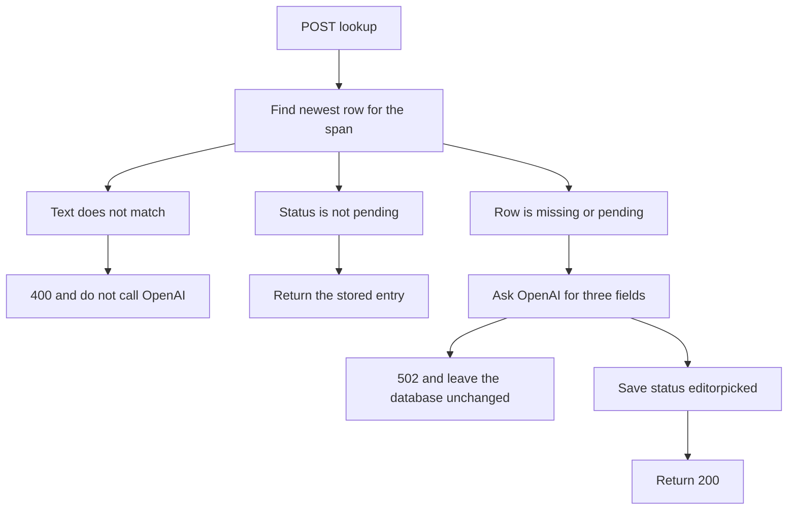

# Add POST /entries/lookup

GET [/entries/lookup](src/entries.ts) stays as it is: a missing span still inserts a pending row and returns 404. POST uses the same six inputs and the same span lookup, but a miss or a pending row is completed instead of returned as 404.

## Request and response

`POST /entries/lookup` reads a JSON body:

- `input_text`, `media_id`, `sentence_id`, `start_index`, `end_index`, `user_id`

Validation matches the GET route, including `user_id` starting with `user_` and `end_index` not before `start_index`. The response object matches a successful GET lookup: the public entry fields, without `id`.

The route already ends in `/lookup`, so the existing limiters apply: 10 requests per `user_id` per minute, and 30 per IP per minute. A rejected caller returns 429 before any database or OpenAI call.

## When OpenAI runs

- Text mismatch returns `{ "error": "input text does not match" }` with 400. OpenAI is not called.
- A row whose status is `aigenerated`, `editorpicked`, or `approved` is returned unchanged.
- A missing row, or the newest row still `pending`, is sent to OpenAI. The saved status is `editorpicked`, as requested, rather than `aigenerated`.
- The model fills only `definition` (`english` and `vietnamese`), `part_of_speech`, and `phonetic`. `usage` stays `[]`, `subtitles` stays `[]`, and `allowed_roles` stays `["standard"]`.
- A new row stores the request's `user_id` and the current `created_at`. Updating a pending row keeps its original `user_id` and `created_at`, and appends the current time to `updated_at`. The lookup query must select `id` so that update targets the same newest row.
- If the key is missing, OpenAI fails, or the model output is empty or invalid, return `{ "error": "generation failed" }` with 502. Do not insert a row and do not change a pending row.

## OpenAI

Call `https://api.openai.com/v1/chat/completions` with `gpt-4.1-mini` and a strict JSON schema for those three fields. The prompt receives only `input_text` and asks for a short English definition, a Vietnamese definition, the part of speech, and an IPA phonetic spelling. Reuse the existing non-empty string checks before saving.

The key is the Worker secret `OPENAI_API_KEY`. It is not written into [wrangler.jsonc](wrangler.jsonc). Local development reads it from `.dev.vars`, which is already gitignored. The remote value is set with `npx wrangler secret put OPENAI_API_KEY`. Extend the Hono bindings in [src/entries.ts](src/entries.ts) with `{ OPENAI_API_KEY: string }` so the secret is typed without editing the generated Worker types.

## Check

With the local server running, confirm a finished row is returned without a model call, and a mismatched word returns 400. A missing span can be checked only after `OPENAI_API_KEY` is present in `.dev.vars`: the response is 200, the saved status is `editorpicked`, and the three generated fields are non-empty. Delete the row created by that check.
